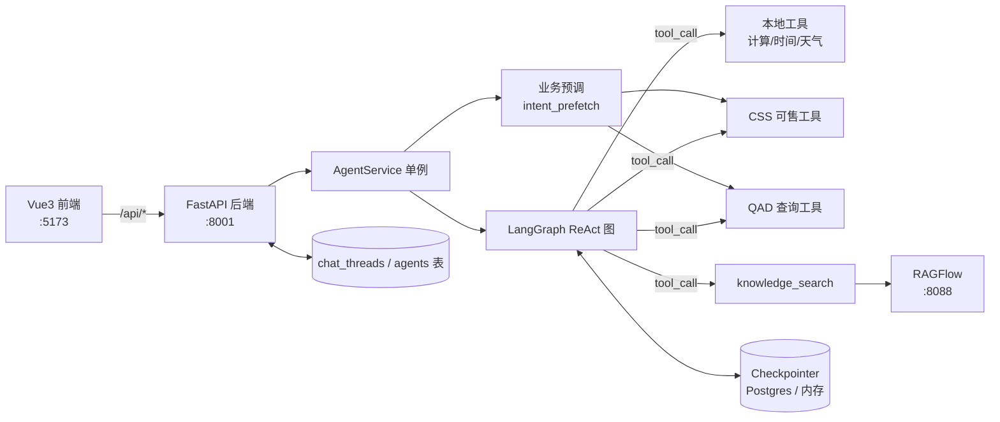
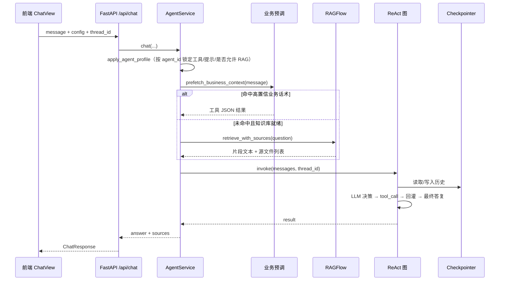

# LangGraph Agent 工程说明

> 版本：v1.0　｜　更新日期：2026-10-30　｜　适用范围：本仓库全部代码

---

## 1. 项目定位

一个**企业业务 AI 助手平台**。核心是用 LangGraph 的 ReAct 模式驱动大模型，把企业内部系统（CSS 可售诊断、QAD 价格/订单查询）和 RAGFlow 知识库统一包装成「工具」，由模型自主判断调用哪一个，最终用中文给出业务结论。

典型使用场景：

- 「CSC70173 订单状态是什么？」 → 模型调 QAD 订单状态接口回答
- 「客户 ZHXSYLD1 的物料 R1600RC30000C 能不能卖？」 → 调 CSS 可售诊断接口
- 「帮我总结这篇论文的第三章」 → 调 RAGFlow 知识库检索

## 2. 技术栈

| 层 | 技术 | 说明 |
|------|------|------|
| 编排 | LangGraph `create_react_agent` | 模型 ↔ 工具循环 + Checkpointer 记忆 |
| 模型 | 智谱 `glm-4-flash` | 走 OpenAI 兼容协议，用 `ChatOpenAI` 封装，可换任意兼容模型 |
| 后端 | FastAPI + Pydantic v2 + uvicorn | 端口 8001，Swagger 在 `/docs` |
| 前端 | Vue3 + Vite + vue-router | 端口 5173 |
| 知识库 | RAGFlow（独立容器） | 端口 8088，本工程仅通过 HTTP 调用 |
| 持久化 | PostgreSQL（可选） | 未配置时降级为本地 JSON / 内存 |
| 部署 | Docker Compose | Agent 与 RAGFlow 同仓分容器编排 |

## 3. 整体架构



设计原则：**RAGFlow 不并入 Python 进程**。同一 Git 仓库可以用总 Compose 一起启停，但运行时是独立容器，通过 HTTP 交互，避免 RAGFlow 的重依赖污染 Agent 进程。

## 4. 目录结构

```text
LangGraph_Agent/
├── agent/                    # LangGraph 核心
│   ├── graph.py              # 组装 ReAct 图 + 系统提示
│   ├── llm.py                # 智谱模型封装
│   ├── tools.py              # 工具集汇总（本地 + CSS + QAD + 知识库）
│   ├── checkpoint.py         # Checkpointer 工厂（Postgres / MemorySaver）
│   ├── response.py           # 从图结果提取最终答复文本
│   ├── intent_prefetch.py    # 高置信话术的业务预调（弱模型补丁）
│   ├── css/                  # CSS/SAAF 平台工具
│   │   ├── client.py         # 登录验签、certificate 缓存
│   │   ├── tools.py          # 可售诊断、快码字典工具
│   │   ├── lookup.py         # 快码查询封装
│   │   └── slots.py          # 中文槽位解析（客户/物料/订单类型）
│   ├── qad/                  # QAD 接口工具
│   │   └── tools.py          # 价格配置查询、订单状态查询
│   └── ragflow/              # 知识库客户端
│       ├── client.py         # 检索 + 文档下载
│       └── tools.py          # knowledge_search 工具定义
├── api/                      # FastAPI 层
│   ├── main.py               # 路由入口
│   ├── agent_service.py      # 进程级单例，管理图与配置指纹
│   ├── schemas.py            # Pydantic 请求/响应模型
│   ├── agent_store.py        # Agent 目录持久化
│   ├── chat_store.py         # 会话列表元数据持久化
│   └── env_config.py         # .env 读写
├── web/                      # Vue3 前端
│   └── src/
│       ├── views/            # 首页 / 对话 / Agent / 设置
│       ├── stores/           # Pinia 状态
│       └── api.js            # 后端接口封装
├── deploy/                   # Docker 编排与运维脚本
├── scripts/                  # 数据库初始化、Agent 导入
├── data/                     # 本地降级数据（JSON）
├── docs/                     # 项目文档
├── main.py                   # CLI 入口（早期/教学用）
├── app.py                    # Streamlit 入口（早期/教学用）
└── requirements.txt
```

## 5. 单轮对话的完整链路



关键点说明：

1. **配置随请求下发**。前端每次携带完整 `config`（模型参数、工具白名单、RAGFlow 配置、`agent_id`、`system_prompt`），后端不锁死服务端配置，支持多 Agent、多套参数并存。
2. **配置指纹机制**。`AgentService._fingerprint()` 把 12 个配置项拼成元组，与上次比对；一致则复用已编译的图，不一致才重建，避免每次请求都重新编译 LangGraph。
3. **业务预调优先于知识库检索**（互斥）。`prefetch_business_context` 用正则识别「8 位单号 + 订单状态」「客户 + 物料 + 是否可售」句式，直接同步调工具，把 JSON 结果和「禁止说无法查询」的指令注入用户消息。这是为 `glm-4-flash` 这类弱模型设计的补丁——它们常只口头说「我需要调用工具」却不真正发起 tool_call。
4. **RAG 自动检索**。启用且配置齐全时，先检索再把片段 + 引用编号对照表拼进消息，要求模型用 `[1]`、`[2]` 形式引用，编号必须与源文件列表一致。
5. **Agent 档案约束**。若 `agent_id` 对应档案里 `ragEnabled=false`，即使用户勾选了知识库也会被强制关闭；档案中的 `tools` 列表直接锁定工具白名单。

## 6. 工具清单

| 工具名 | 来源 | 作用 |
|--------|------|------|
| `calculator` | 本地 | 安全四则运算（字符白名单，禁任意代码执行） |
| `get_current_time` | 本地 | 返回本地日期时间 |
| `get_weather` | 本地 | 模拟天气数据，仅用于演示工具调用 |
| `css_fetch_certificate` | CSS | 获取验签 key，可单独用于排查登录 |
| `css_check_sellable` | CSS | 查询物料对指定客户/订单类型是否可售 |
| `css_explain_unsellable` | CSS | 查询不可售原因（原因码 + 中文说明 + 检查步骤） |
| `css_list_lookup_catalog` | CSS | 列出本地已登记的快码经验目录 |
| `css_lookup_values` | CSS | 按 `lookupType` 实时拉取快码字典值 |
| `qad_check_price_configured` | QAD | 查客户 + 物料是否已配置有效价格 |
| `qad_check_order_status` | QAD | 查 QAD 销售订单状态（8 位单号） |
| `knowledge_search` | RAGFlow | 知识库检索，启用后动态注册 |

### CSS 验签机制

`agent/css/client.py` 负责登录拿 `certificate`。该凭证自上次使用起 30 分钟空闲会自动重新登录（`CSS_CERT_TTL_SEC`，默认 1800 秒）。所有 CSS 业务工具内部会自动先取凭证再发请求，无需模型显式调用登录工具。

### QAD 状态码

状态码含义优先从 CSS 快码 `QAD_ORDER_STATUS` 实时加载，加载失败时回退到 `agent/qad/tools.py` 内置的兜底表（01 待确认、06 已解信、15 已开票等）。

## 7. API 接口

| 方法 | 路径 | 说明 |
|------|------|------|
| GET | `/` | 服务提示 |
| GET | `/api/health` | 健康检查 |
| GET | `/api/tools` | 工具列表 |
| GET | `/api/defaults` | 默认模型配置 + 工具 + RAGFlow 预置 |
| POST | `/api/chat` | 对话主接口 |
| GET | `/api/threads/{thread_id}/messages` | 按会话 ID 读历史（F5 刷新恢复） |
| GET | `/api/users/{user_id}/threads` | 按用户列会话列表 |
| DELETE | `/api/users/{user_id}/threads/{thread_id}` | 删除会话记录 |
| GET | `/api/agents` | Agent 目录列表 |
| GET | `/api/agents/{agent_id}` | Agent 详情 |
| PUT | `/api/agents/{agent_id}` | 创建/更新 Agent |
| POST | `/api/config/save` | 将页面配置写入根目录 `.env` |
| POST | `/api/ragflow/ping` | 探测 RAGFlow 连通性 |
| POST | `/api/ragflow/download` | 代理下载 RAGFlow 文档 |

## 8. 前端页面

| 路由 | 页面 | 用途 |
|------|------|------|
| `/` | 首页 | 状态总览与功能入口 |
| `/chat` | 智能对话 | 独立问答页，可调温度/工具/知识库开关 |
| `/agents` | Agent 列表 | 浏览全部业务助手 |
| `/agents/:id` | Agent 详情 | 能力说明 + 流程图（Mermaid 渲染） |
| `/agents/:id/chat` | Agent 对话 | 带档案约束的对话 |
| `/settings/model` | 模型服务 | 模型参数配置 |
| `/settings/knowledge` | 知识库 | RAGFlow 配置与连通性探测 |
| `/settings/system` | 系统 | 环境同步 |

## 9. 配置项（.env）

### 模型

| 变量 | 默认值 | 说明 |
|------|--------|------|
| `ZHIPU_API_KEY` | 空 | 智谱 API Key，必填 |
| `ZHIPU_MODEL` | `glm-4-flash` | 模型名称 |
| `ZHIPU_BASE_URL` | `https://open.bigmodel.cn/api/paas/v4/` | OpenAI 兼容地址 |
| `ZHIPU_TEMPERATURE` | `0.7` | 默认温度 |

### 知识库

| 变量 | 默认值 | 说明 |
|------|--------|------|
| `RAGFLOW_ENABLED` | `false` | 是否启用检索 |
| `RAGFLOW_BASE_URL` | `http://127.0.0.1:8088` | RAGFlow 地址 |
| `RAGFLOW_API_KEY` | 空 | RAGFlow API Key |
| `RAGFLOW_DATASET_IDS` | 空 | 数据集 ID，逗号分隔 |

### 数据库

| 变量 | 默认值 | 说明 |
|------|--------|------|
| `DATABASE_URL` | 空 | Postgres 连接串；配置后记忆与会话列表持久化，否则用 MemorySaver + JSON |

### CSS

| 变量 | 默认值 | 说明 |
|------|--------|------|
| `CSS_DOMAIN` | `https://dms.aosmith.com.cn` | 域名 |
| `CSS_LOGIN_URL` | 内置 | 登录地址 |
| `CSS_USER_NAME` / `CSS_PASSWORD` | 空 | 登录凭证 |
| `CSS_CERT_TTL_SEC` | `1800` | 凭证空闲过期秒数 |
| `CSS_DIAGNOSE_URL` / `CSS_API_CHECK_URL` | 空 | 直接指定可售诊断完整地址 |
| `CSS_DIAGNOSE_PATH` | `/api/orderInterfaceServer/errorMsgInfoService/diagnoseMaterialSellable` | 可售诊断路径 |
| `CSS_LOOKUP_URL` | 内置 | 快码查询地址 |

### QAD

| 变量 | 默认值 | 说明 |
|------|--------|------|
| `QAD_BATCH_GET_QAD58_URL` / `QAD_PRICE_URL` | `http://172.30.109.112:8015/api/QadRealTime/BatchGetQad58` | 价格接口 |
| `QAD_SALES_ORDER_STATUS_URL` / `QAD_ORDER_STATUS_URL` | `http://172.30.109.112:8015/Qad/SalesOrderStatusWS` | 订单状态接口 |

## 10. 持久化设计

工程里有**两套独立存储**，容易混淆：

| 存什么 | 存在哪 | 有无 `DATABASE_URL` 的差异 |
|--------|--------|---------------------------|
| 消息正文（多轮对话历史） | LangGraph Checkpointer | 有 → `PostgresSaver`（连接池 10，重启不丢）；无 → `MemorySaver`（重启清空） |
| 会话列表元数据（用户、thread_id、标题、更新时间） | `chat_threads` 表 / `data/chat_threads.json` | 自动切换 |
| Agent 目录（名称、工具、提示、流程图） | `agents` 表 / 内置种子数据 | 首次建表写入种子 |

`get_history` 读取历史时做了两处清洗：把注入过的「用户问题：xxx」前缀还原成用户原话；跳过只含 `tool_calls` 的中间 AIMessage，避免前端出现半截消息。

## 11. 启动方式

### 本地开发

```powershell
cd D:\study\LangGraph_Agent
pip install -r requirements.txt
python -m api.main          # 后端 :8001

cd web
npm install
npm run dev                 # 前端 :5173
```

### Docker 总栈（含 RAGFlow）

```bash
chmod +x deploy/*.sh
./deploy/bootstrap-ragflow.sh    # 克隆 RAGFlow 到 third_party/，生成 ragflow.env
./deploy/start.sh                # Agent :8001 + RAGFlow :8088
./deploy/stop.sh
```

容器内 Agent 访问 `http://ragflow-cpu`，浏览器访问 RAGFlow 用 `http://localhost:8088`。

### 其他入口

- `python main.py`：命令行交互版，固定 `thread_id="cli-session"`，仅本地工具，不接数据库。
- `streamlit run app.py`：Streamlit 版，侧边栏可配模型与工具，用 `MemorySaver` 保持记忆。

这两个是早期/教学入口，功能少于 FastAPI 版。

## 12. 接口对接步骤（RAGFlow）

1. 启动总栈，打开 `http://localhost:8088`，创建 Dataset、上传并解析文档。
2. 在 RAGFlow 控制台创建 API Key，复制 Dataset ID。
3. 在「知识库」页或 `.env` 填写 `RAGFLOW_*`，并勾选启用。
4. 点击「探测连通」验证 → 到「智能对话」页提问，回答会带 `[n]` 引用编号，源文件可下载。
5. 检索接口：`POST {base_url}/api/v1/retrieval`，默认 `page_size=6`、`similarity_threshold=0.2`。

## 13. 设计取舍与已知限制

| 项 | 说明 |
|----|------|
| 配置随请求下发 | 灵活支持多 Agent 多参数，但 API Key 在网络传输中，生产环境需加鉴权与 HTTPS |
| 业务预调双刃剑 | 保证确定性（命中正则必调工具、必出结果），但会跳过语义检索；槽位解析错误时模型只能如实转述错误结果 |
| 正则覆盖有限 | 预调只覆盖订单状态、可售两类句式，新增业务需同步扩展 `intent_prefetch.py` |
| 无完整账号体系 | `user_id` 仅为轻量标识，用于分会话列表，无鉴权、无隔离 |
| 图重建粒度粗 | 任一配置项变化即整图重建，`system_prompt` 微调也会触发 |
| 单例串行风险 | `ensure_agent` 用线程锁保护重建，但 LangGraph 图本身并发调用需依赖其内部安全性 |
| 演示工具保留 | `get_weather` 为固定模拟数据，不可用于真实业务判断 |

## 14. 常见问题

| 现象 | 处理 |
|------|------|
| 前端连不上后端 | 先确认 `python -m api.main` 已起，端口 8001 未被占用 |
| 提示未配置 API Key | 在 `.env` 写 `ZHIPU_API_KEY`，或在请求 `config.api_key` 中下发 |
| 探测 RAGFlow 失败 | 检查服务是否启动、端口、API Key、Dataset ID 是否正确 |
| 检索不到片段 | 文档是否解析完成；`similarity_threshold` 是否过高 |
| 模型反复说「无法查询」 | 检查该 Agent 档案的 `tools` 是否包含对应工具；确认未命中预调正则 |
| 重启后历史丢失 | 未配置 `DATABASE_URL`，改用 Postgres 或接受短期内记忆 |
| CSS 工具报验签失败 | 检查 `CSS_USER_NAME` / `CSS_PASSWORD`；凭证空闲 30 分钟会过期，工具会自动重登 |

## 15. 扩展指引

**新增一个业务工具**

1. 在 `agent/<新模块>/tools.py` 中用 `@tool` 装饰器定义函数，返回 JSON 字符串（`ensure_ascii=False`）。
2. 导出一个 `XXX_TOOLS: list[BaseTool]` 列表。
3. 在 `agent/tools.py` 的 `build_toolset()` 中并入。
4. 如属高置信话术、需要绕过弱模型的调用犹豫，在 `intent_prefetch.py` 中加正则分支。
5. 前端「工具」勾选列表会自动带出（走 `/api/tools`）。

**新增一个 Agent 档案**

写入 `agents` 表（或调用 `PUT /api/agents/{id}`），关键字段：`tools`（白名单）、`ragEnabled`、`systemPrompt`、`flowchart`（Mermaid 源码，详情页会渲染）。
